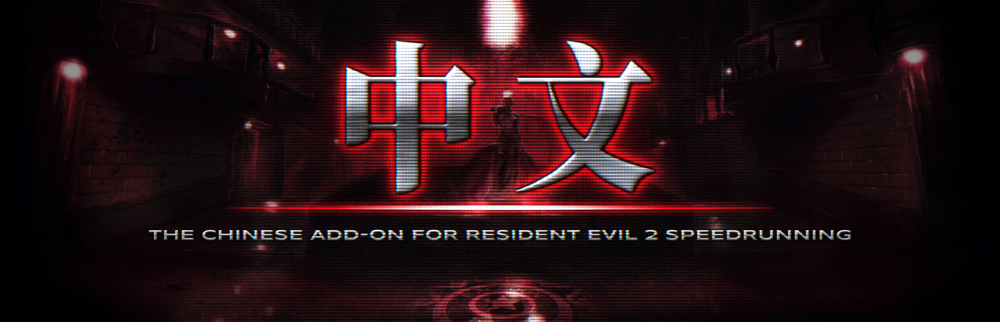

# Zhongwen Patch



A chinese Speedrun add-on mod with extras for the PC version of Resident Evil 2 (1998)
running on [Classic REbirth](https://classicrebirth.com).

为 Classic REbirth 上的《生化危机2》PC 版提供中文文本与扩展功能（非官方）。

Targeted fixes to the game and the extras, after 1.0. **Classic REbirth for the Chinese PC release of Resident Evil 2** (生化危机2, Simplified Chinese, 1999): the game in Chinese on `bio2 1.10.exe` with all of Classic REbirth's features. The patch adds its own files only and never changes the game's: nothing in your install is deleted or overwritten.

## What's new in 1.3

**Supreme Skip** , Annette's scene (Leon A, ROOM60C0, the G-Virus): a skip in the middle of a voiced line no longer leaves the scene standing still until the line is over (up to 13.5 s, with no key working). The patch now cuts the line at the skip, and control comes back about 0.3 s after the press. Thanks to the testers who reported it.
**Nothing else changed:** the packages have the same files as 1.2. Tested at seven points of the scene; new games skipped there still get the G-Virus, and without a skip the scene plays as before.

## You need

- **Your own copy of the game**, installed from the retail discs: the Leon disc, the Claire disc or both in one folder.
- **Classic REbirth** for Resident Evil 2 (`ddraw.dll`): download it from [its page](https://classicrebirth.com/index.php/download/resident-evil-2-classic-rebirth/). This patch was made with the build offered there, `re2cr-2024-09-01.7z`. It is not included because its author asks that it stay a stand-alone download.
- **`bio2 1.10.exe`**, the executable from Sourcenext's official 1.1.0 update: download it from [Classic REbirth's site](https://classicrebirth.com/index.php/download/biohazard-2-sourcenext-1-1-0-patch/). It is not included.

## Install

1. Put `bio2 1.10.exe` and Classic REbirth's `ddraw.dll` in the game folder (the one with `COMMON`, `REGIST` and `Pl0` or `PL1`).
2. Unzip `Zhongwen_Patch_v1.3.zip` and drag the contents of the folder inside into the game folder.
3. Open `bio2 1.10.exe`, press **OK** in **CONFIGURATION**, then pick **生化危机2** in **MOD SELECTION**.

## Install the Speedrun Edition

**生化危机2: SPEEDRUN EDITION** is Gemini's *BIOHAZARD 2: SPEEDRUN EDITION* on the Chinese release. It is not included: a setup makes the Chinese one from your own copy, in a few seconds.

1. Install Zhongwen Patch first (above).
2. Install [7-Zip](https://www.7-zip.org) if you do not have it: the setup needs it.
3. Download the Speedrun Edition from [Classic REbirth's site](https://classicrebirth.com/index.php/download/re2-sr-2020/). Put its `mod_sr_crypto.7z`, as it is (do not unpack it) in the game folder.
4. Double-click `Set up Speedrun Edition.bat` in the game folder.
   - It makes `mod_chinese_sr.7z`.
   - If you put `mod_sr_crypto.7z` in the game folder, it moves it into `_ZhongwenPatch`, so MOD SELECTION lists only the Chinese one.
   - It ends with *mod_chinese_sr.7z built: 生化危机2: SPEEDRUN EDITION (...; Action hotkey on)*. Press any key to close the window.
5. Open `bio2 1.10.exe`, press **OK** in CONFIGURATION and pick **生化危机2: SPEEDRUN EDITION** in MOD SELECTION.

## Features

- **Chinese text everywhere the 1999 release had it:** title, menus, messages, items, documents, the opening narration, the EX.BATTLE briefing and ending message, and the results screens. It is all drawn from your install's own Chinese data; the mod carries no game data.
- **Enable Chinese** in CONFIGURATION (*Misc*). Untick it to play in English.
- **The warning screen in Chinese** at startup, then the Chinese title.
- **Action hotkey:** hold a key (Space by default) to use doors, ladders and lifts on the first frame you reach them, under the same rules as the action button.
- **Rebind controls:** set the keys and controller buttons for each action from the CONFIGURATION window.
- **Supreme Skip:** the Door & Cutscene Skip mod by Resevilnemesis30 as one option. It skips door sequences, stairs and ladders, and lets the cancel button skip cutscenes. It also makes the inventory faster and starts the timer at 0.00. The files come prepared with the Chinese text of the retail discs. This patch fixes some of the mod's scenes with its own code; descawed's update is not used.
- **Both Chinese versions:** 生化危机2 and **生化危机2: SPEEDRUN EDITION**, Gemini's Speedrun Edition in Chinese. Its title reads *SPEEDRUN EDITION, GEMINI 2020*; it uses the original timer, with Quick Turn and Tactical Reload off. The Speedrun Edition itself is not included: see *Install the Speedrun Edition* above. MOD SELECTION lists only these two.
- **Fixes in memory:** the Sourcenext update's corrections to the discs' rooms, the results screen in Chinese, room models (the main hall's emergency ladder), and a lock that keeps the discs' Indeo 5 movies off.
- A *Zhongwen Patch 1.3* line in CONFIGURATION shows that the patch is running.

## Known limitations

- Video scenes stay off: Classic REbirth 1.0.9 crashes on the discs' Indeo 5 movies.
- With only the Claire disc installed, play in English for now. The Chinese text is read from the Leon disc's `REGIST\leon.exe`.
- Classic REbirth's own screens (Load, Save, CONFIGURATION), *Yes/No* in choices and the maps are in English. *Yes/No* and the maps were in English in the original Chinese release too.
- The Chinese warning needs a Chinese font of Windows (Microsoft YaHei, SimHei or SimSun); without one, the warning stays in Japanese.

## Credits and licenses

- **Classic REbirth** by Gemini (https://classicrebirth.com), under CC BY-NC-ND 4.0: not included, downloaded from its page. It is free and may not be sold.
- **BIOHAZARD 2: SPEEDRUN EDITION** by Gemini, part of Classic REbirth: not included. The setup makes the Chinese one from your own copy.
- **Door & Cutscene Skip** by Resevilnemesis30, shared with credit as its author allows (never for money).
- descawed's update 1.1 listed the scenes that this patch fixes with its own code.
- **Zhongwen Patch** is free software under the GNU General Public License v3.0 (`LICENSE.txt` in the zips); its source code is in this repository. The license covers only Zhongwen Patch's own work.
- Resident Evil 2 / BIOHAZARD 2 / 生化危机2 belongs to Capcom. `bio2 1.10.exe` is Sourcenext's. Zhongwen Patch is not affiliated with or endorsed by Gemini, Capcom or Sourcenext. See `_ZhongwenPatch\NOTICE.txt`.

## Special thanks

To the speedrunners **Shyanji** and **im4rcuss**, who helped test Zhongwen Patch throughout its development, up to version 1.3.

## SHA-256

```
f3a5caa779ab35b03df31fd106d42e83296d2f5f8722953e942ecb75351c12c7  Zhongwen_Patch_v1.3.zip
```
